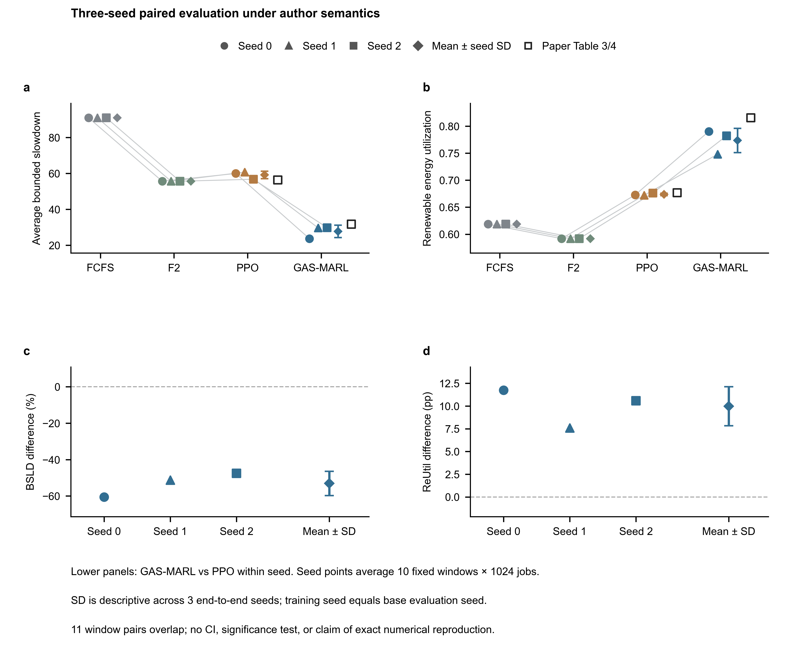
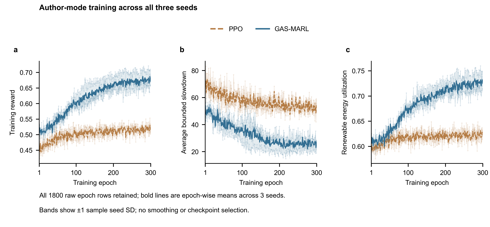

# GAS-MARL 三种子基线验证报告

种子0、1、2的GAS-MARL和PPO均已完成300轮训练及统一配对评测，最后一批于北京时间10月23日16时49分结束。本报告核对六份完整训练状态并汇总可比的三种子结果，保留此前单种子报告和全部原始输出。

## 一 复现到什么程度

在本次限定配置下，三个种子的作者模式结果均支持GAS-MARL相对PPO降低平均BSLD并提高绿电利用率。跨种子均值仍与论文不同，且只覆盖一个工作负载和一种回填策略；据此可确认本阶段基线验证完成，不能宣称整篇论文或所有表格已复现。

| 种子 | GAS-MARL BSLD ↓ | PPO BSLD ↓ | GAS-MARL 绿电 % ↑ | PPO 绿电 % ↑ |
|---|---|---|---|---|
| 0 | 23.6781 | 59.9781 | 79.02 | 67.28 |
| 1 | 29.6191 | 60.7554 | 74.81 | 67.21 |
| 2 | 29.7957 | 56.7671 | 78.21 | 67.62 |
| 均值 ± SD | 27.6976 ± 3.4821 | 59.1668 ± 2.1143 | 77.35 ± 2.24 | 67.37 ± 0.22 |

以三种子均值之比计算，GAS-MARL的BSLD比PPO低53.19%，ReUtil高9.97个百分点。这是复现方法与对照算法的比较，不是新算法收益。

每个种子的评测点是十段1024作业结果的算术均值；表中SD是三个种子均值之间的样本标准差。训练种子与基础评测种子同号，因此这里描述端到端随机性，不能分解为纯训练方差。

BSLD越低越好；ReUtil越高越好，其分母为集群总耗能。十个固定窗口有11对重叠，不能把30个窗口当作30次独立训练。本报告不进行显著性检验。

## 二 作者模式对照与配对差异

图1 三种子作者模式统一配对评测。上排为绝对指标，下排为同种子GAS-MARL相对PPO的差异；每个种子点为十窗均值，菱形和误差条为三种子均值及样本SD。空心方块是论文Table 3和4锚点。120条作者模式记录全部参与统计。

| 算法 | 论文BSLD | 论文绿电 % | BSLD偏差 | 绿电偏差 pp |
|---|---|---|---|---|
| GAS-MARL | 31.738 | 81.54 | -12.73% | -4.19 |
| PPO | 56.358 | 67.67 | +4.98% | -0.30 |

上述偏差描述三种子均值与发表均值的差别。性能排序重复出现，并不意味着软件、采样和实现语义的偏离已被消除。

## 三 训练轨迹与证据核验

图2 六次训练的1800行原始记录全部保留。每种算法粗线为同一轮三个种子的均值，色带为样本SD，浅线为各次训练；未选择最好轮次，也未做移动平均。

| 核验项目 | 核验范围 |
|---|---|
| 完整训练 | 六份CSV均300行；日志epoch连续1至300，并与CSV逐行一致 |
| 最终模型 | 六份checkpoint均为第300轮；与独立actor和critic权重逐tensor相等，参数有限 |
| 完整状态 | 双Adam、全局及环境RNG与CSV历史齐全，元数据匹配seed和配置 |
| 运行与来源 | seed0原批次8步与seed1/2批次16步均正常退出；源码和输入数据SHA256核验 |
| 统一评测 | 3种子×2模式×4算法×10段，共240条记录；均值、CSV与奖励公式核验 |
| 配对零效应 | 三个种子的FCFS、F2和PPO在author与paper模式逐行一致 |

训练源提交分别为seed0的0b6541e和seed1/2的8915ae3；作者参考版本为0d89df5。后续工程修复和评测播种变更有单独记录，核验以实际运行保存的源码快照和输入清单为准。

环境为Python 3.11.15、PyTorch 2.7.1+cu128、NumPy 1.24.4、RTX 5060。作者PyTorch 2.1.1因显卡兼容升级；NumPy重复约束统一为1.24.4，OpenCV固定4.11.0.86。这些是复现版本偏离，未计作算法创新。

## 四 截止语义敏感性与研究边界

所有模型均按作者语义训练。paper模式只改变被测试发现的Type 2延迟截止事件处理，用同一第300轮模型和配对随机流评测；没有训练新方法。早期seed0 legacy评测存在共享随机流混杂，本报告统一使用另存的paired评测，未混入其较好数字。

| 种子 | BSLD  author → paper | BSLD变化 | 绿电 %  author → paper |
|---|---|---|---|
| 0 | 23.6781 → 20.7419 | -12.40% | 79.02 → 79.46 |
| 1 | 29.6191 → 42.6511 | +44.00% | 74.81 → 74.28 |
| 2 | 29.7957 → 29.5825 | -0.72% | 78.21 → 78.47 |

paper模式GAS-MARL的跨种子BSLD为30.9919 ± 11.0224，ReUtil为77.40% ± 2.75个百分点。种子1的BSLD恶化且绿电利用率下降，说明截止语义修正没有带来一致提升，不能把工程修正包装成算法贡献。

已完成范围为Lublin-256、Green-Backfilling以及FCFS、F2、PPO和GAS-MARL的比较。论文中的GA、LPTPN、Cirne、Jann及其他回填配置尚未完成；相同轨迹上的十个窗口也不是严格隔离的外部分布测试。

下一阶段先补核直接近邻，再筛选可证伪的候选。绿电预测误差下延迟与回填稳健性仍待查新，不能因为加入预测、注意力或双critic便认定创新。若开展小试，应复用固定权重、冻结真实供给与作业，仅扰动调度器可见的未来预测，并先验证零扰动完全退化。

本阶段未追加长期训练。代码、图表和小型证据同步研究分支及草稿PR；权重、虚拟环境与用户论文PDF保留本地。首轮报告继续保存，自动跟进保持低频，仅在完成、失败或有实质科研发现时通知。

复核入口为scripts/verify_multiseed.py与scripts/analyze_multiseed.py。研究证据目录multiseed保存逐序列数据、每种子与跨种子汇总、源输入哈希和模型核验记录，图表附源数据与绘图脚本。
