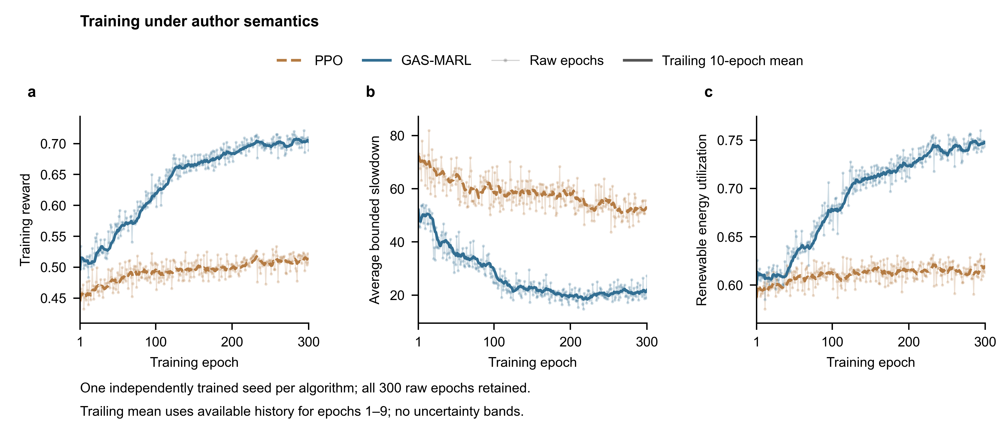
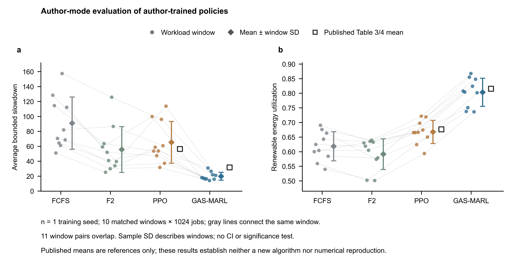

# GAS-MARL 首轮基线验证报告

完整流水线完成于北京时间2026年10月22日 04:18，用时13.57小时。当前交付为一组独立训练种子的完整基线及固定权重语义对照。

## 1. 结论与论文对照

作者模式的主要性能排序得到支持：本次GAS-MARL在平均BSLD和绿电利用率上均优于PPO。不过，单个训练种子、软件版本偏离和随机评测不足以证明论文数值已复现，也不构成新的算法贡献。

| 算法 | 本次BSLD↓ | 本次绿电/%↑ | 论文BSLD | 论文绿电/% |
|---|---|---|---|---|
| FCFS | 91.0012 | 61.86 | — | — |
| F2 | 55.6667 | 59.18 | — | — |
| PPO | 65.2737 | 66.78 | 56.358 | 67.67 |
| GAS-MARL | 19.8393 | 80.34 | 31.738 | 81.54 |

相对本次PPO，GAS-MARL的BSLD低69.61%，绿电利用率高13.55个百分点。此比较描述本次相同十段输入上的结果，不应解释为对论文方法的新改进。

相对论文Table 3/4，GAS-MARL的BSLD偏差为−37.49%，ReUtil偏差为−1.20个百分点；PPO分别为+15.82%与−0.89个百分点。BSLD降低与绿电利用率降低同时存在，不能只挑选有利指标判定复现成功。

指标方向：BSLD越低越好，ReUtil越高越好。ReUtil的分母是集群总耗能；表中百分数不是“可用绿电消纳率”。

## 2. 训练轨迹与逐序列结果

图1｜两算法全部300轮训练记录。浅线保留每轮均值，实线为后向10轮移动均值；首9轮使用已有轮数。只有一个独立训练种子，不绘制种子间置信区间。

图2｜作者模式的十段1024作业评测。保留各段原始点，均值和样本SD仅描述片段差异；空心标记为论文锚点。十个作业窗口中有11对重叠，不把这些点视为十次独立训练。

## 3. 随机采样混杂与隔离对照

原评测程序只在整次评测开始播种一次，随后不同算法和不同片段共用随机流。截止语义改变MARL的轨迹长度后，会改变后续PPO所用的随机数。原始两模式的PPO第一段相同、后九段不同；PPO的延迟动作固定为零，因此其差异不能归因于截止修正。

为隔离该混杂，保留全部原始结果和最终第300轮权重，新增paired模式：每个算法、每段起点分别重置Python、NumPy、Torch及环境随机状态，两种语义使用同一派生种子。没有重新训练模型，也没有覆盖原评测。

| 固定模型 | BSLD：author → paper | 绿电/%：author → paper |
|---|---|---|
| PPO | 59.9781 → 59.9781 | 67.28 → 67.28 |
| GAS-MARL | 23.6781 → 20.7419 | 79.02 → 79.46 |

PPO、FCFS、F2在两模式下逐行完全相同，零效应对照通过。GAS-MARL的BSLD变化为-12.40%，绿电利用率变化为+0.44个百分点；逐段BSLD有改善、恶化和不变，不能声称所有序列均受益。

隔离对照的方向与原始共享随机流比较不同，说明修复评测设计会影响研究结论。新的author结果与原始author结果也可不同，因为采样种子方案发生改变；两套数字不能混成一个表或挑选最优值。

限制：这仍是同一个作者模式训练的模型、一个评测基础种子。它验证的是Type 2截止事件的语义敏感性，不是独立训练的新方法；需要更多训练和评测种子才能评估稳定性。未进行显著性检验。

## 4. 证据、版本与后续安排

| 核验项目 | 已核实结果 |
|---|---|
| 训练完整性 | 两算法各300行CSV、300条连续epoch日志；各行数值一致 |
| 权重与恢复状态 | 最终checkpoint均为第300轮；网络与独立权重逐tensor一致，参数有限，双Adam与全部RNG齐全 |
| 运行与来源 | 8个步骤退出0、stderr均为空；23个源码快照和6个数据文件SHA256通过 |
| 评测对齐 | 每模式4算法×10段×1024作业；逐序列均值、CSV与奖励公式一致 |

训练源版本：0b6541e；作者参考版本：0d89df5。原作者导入保留于upstream-import。配对评测使用另存的比较脚本和原始权重SHA256清单，训练权重未被改写。原01任务的127轮中断数据与本次完整02任务分开保留。

环境为Python 3.11.15、PyTorch 2.7.1+cu128、NumPy 1.24.4、RTX 5060。相对作者依赖，PyTorch由2.1.1升级以支持显卡，NumPy冲突固定版本统一为1.24.4，OpenCV固定4.11.0.86；这些偏离已进入运行环境证据。绘图依赖在训练完成后安装，未冒充为训练时环境。

工程状态：连续恢复时已完成算法的检查点传递缺陷已补失败测试并修复，不覆盖新检查点，复制失败会明确标记运行失败。该改动属于可靠性修复，不算创新。

下一阶段优先验证跨随机种子的稳定性，再决定是否进入绿电预测误差的创新试验。现有近邻文献已覆盖预测、注意力、双critic和部分风险调度，尚缺关键全文，不能仅凭概念名称声称新颖。新增长期实验需记录独立种子与一致评测协议。

自动定时监测按用户要求保持关闭。代码、小型证据、逐序列数据和可编辑报告同步研究分支；训练权重、虚拟环境及用户论文PDF留在本地。

证据索引：研究目录下的baseline02证据包含原始训练CSV、两套原始逐序列评测、配对评测、核验记录及源文件/数据哈希；图表附源数据CSV与绘图脚本。
